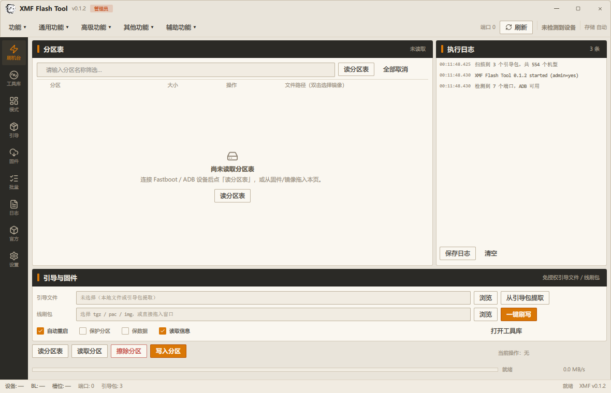
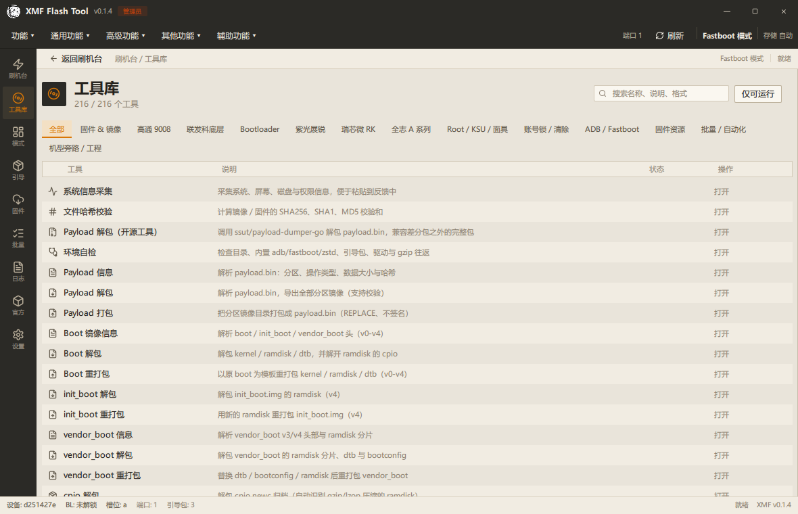
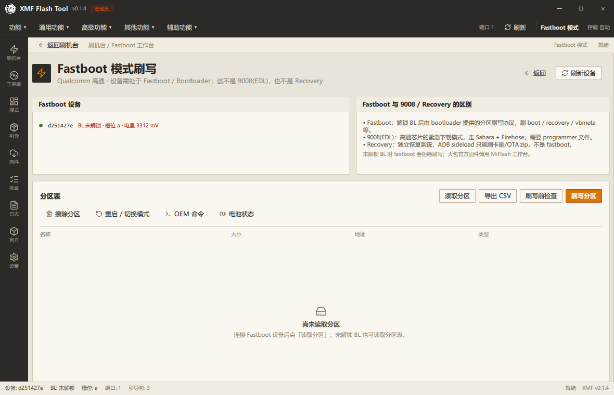
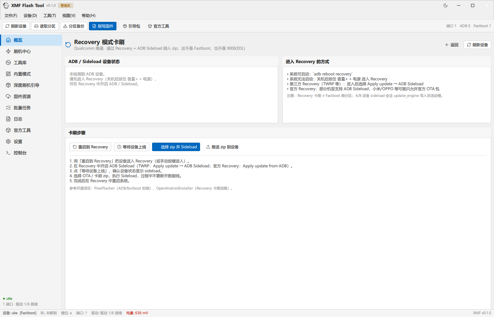
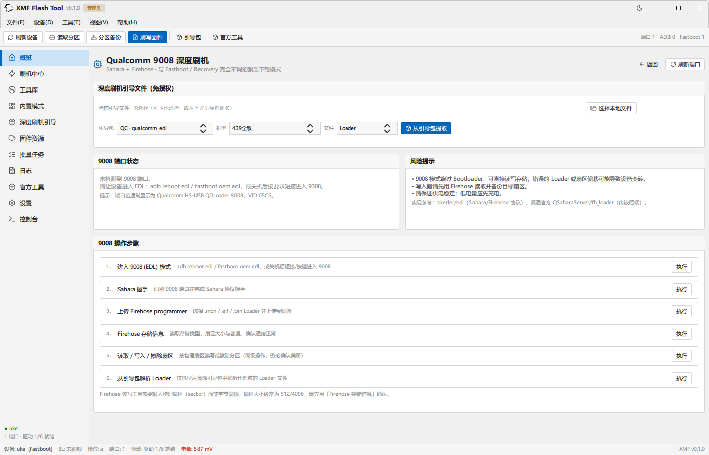
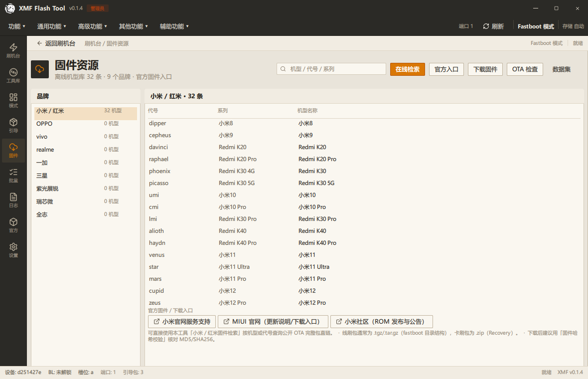
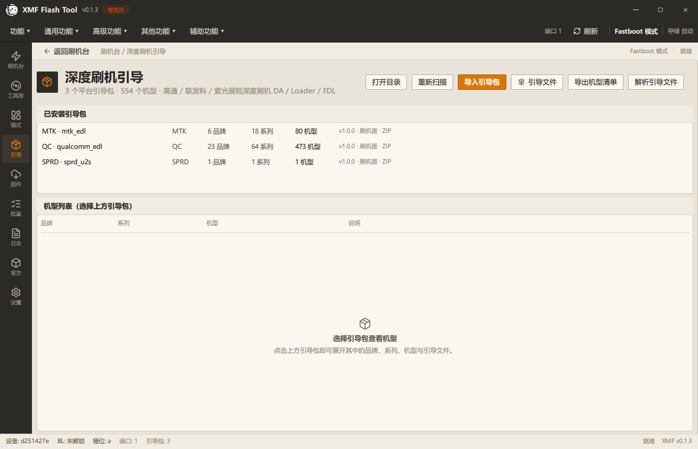
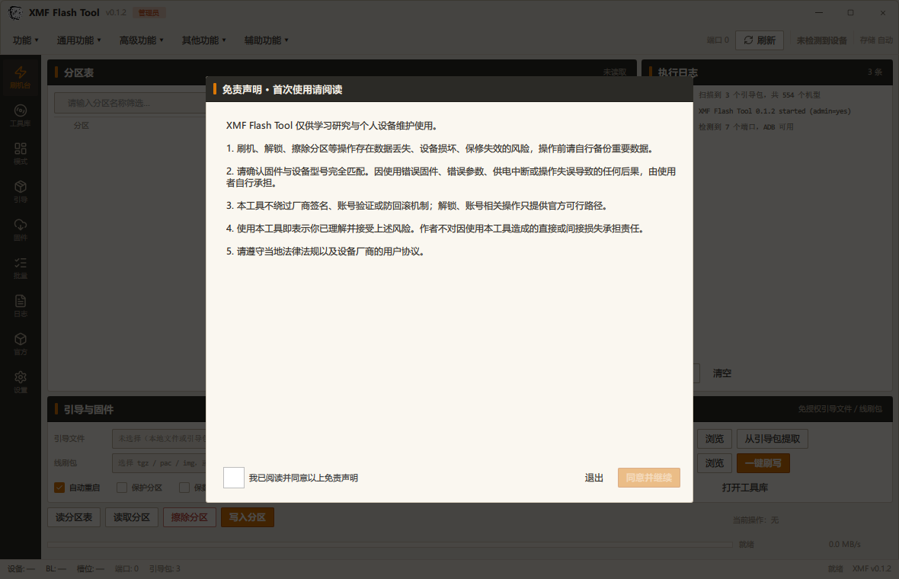
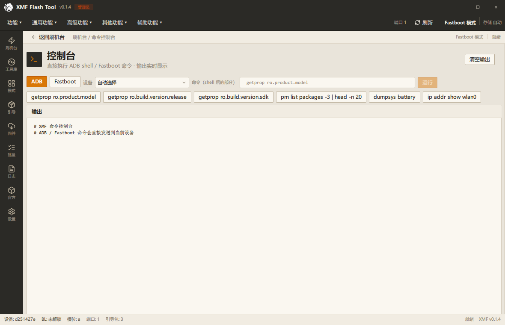
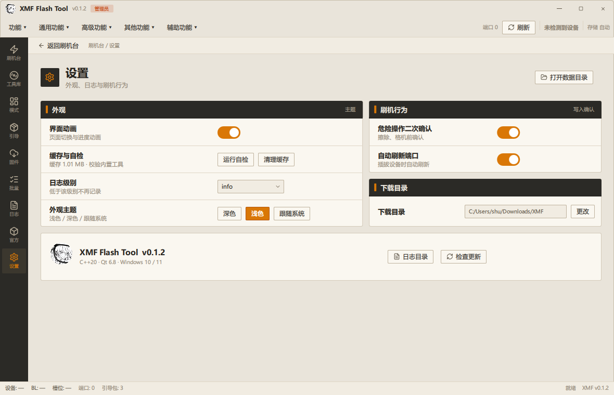

# XMF Flash Tool

**一款面向 Windows 的 C++/Qt6 桌面刷机工具：Fastboot / Recovery / 9008(EDL) 三种模式分流、五个内置工作台、216 个可运行工具。
内置高通、联发科、紫光展锐、瑞芯微、全志平台支持，并原生解析三套平台深度刷机引导包（免授权 DA / Loader / FDL）。**



[](https://github.com/xmz7891/XMF-flash-tool/releases)
[](https://www.qt.io/)
[]()
[]()
[](LICENSE)

---

## 目录

- [简介](#简介)
- [功能特性](#功能特性)
- [界面截图](#界面截图)
- [下载与安装](#下载与安装)
- [快速开始](#快速开始)
- [工具清单](#工具清单)
- [从源码构建](#从源码构建)
- [目录结构](#目录结构)
- [命令行参数](#命令行参数)
- [安全策略](#安全策略)
- [验证](#验证)
- [已知边界](#已知边界)
- [第三方组件与参考项目](#第三方组件与参考项目)
- [免责声明](#免责声明)
- [许可证](#许可证)

## 简介

XMF Flash Tool 使用 **C++20 + Qt 6.8** 编写，主界面是一块**单屏刷机台**：顶部命令菜单 + 左侧图标轨 + 分区表 / 实时日志 / 引导与固件 / 操作进度同屏，
其余功能以叠页打开。默认窗口 1180×760、首次启动居中，最小可缩到 1040×680。浅色 / 深色两套中性主题。

> 核心设计：**Fastboot、Recovery（ADB Sideload）、9008(EDL) 是三种完全不同的协议与设备状态，必须分开处理。**
> 刷机台会先自动识别设备当前模式，再自动/手动进入对应工作台，避免"把 9008 当 fastboot 刷"的误操作。

## 功能特性

### 刷机模式与设备层

- **自动识别设备模式**：ADB / Fastboot / Recovery Sideload / 9008 EDL / MTK BROM / SPRD FDL /
  Rockchip MaskROM / Allwinner FEL；识别后自动打开对应工作台（可关闭），也可手动选择。
- **Fastboot 工作台**：分区表读取、刷写前检查（分区容量 / SHA256 / 电量）、刷写 / 擦除、CSV 导出、重启模式、OEM 命令、电池状态。
- **Recovery 卡刷工作台**：重启到 Recovery、等待设备上线、`adb sideload` 刷 OTA/卡刷 zip、推送文件。
- **Qualcomm 9008 工作台**：Sahara 握手、上传 Firehose programmer、存储信息、扇区读写/擦除、从引导包解析 Loader。
- **其它平台深度模式**：MTK BROM/DA（SP Flash）、Unisoc U2S/FDL（Research Download）、
  Rockchip MaskROM/Loader（RKDevTool）、Allwinner FEL（PhoenixSuit）。
- **深度刷机引导文件**：可本地选择 `.elf/.mbn/.bin` Loader，或按机型从高通/联发科/紫光展锐引导包中
  提取免授权 DA/Loader/FDL，并自动填入刷机工具参数。

### 固件 / 镜像工具链

- payload.bin：信息、解包、打包、增量结构分析
- boot / init_boot / vendor_boot：解析、解包、重打包、ramdisk/cpio 修改
- super 动态分区：信息、拆分、合并、扩缩容
- sparse、vbmeta/AVB、GPT、ELF、zip 卡刷包、压缩格式转换、zstd 解压
- 开机 LOGO 提取与打包、哈希/偏移计算、空白块扫描
- 小米固件检索/下载/OTA、文件识别/解包/校验/分包合并
- RKFW/RKAF、IMAGEWTY（PhoenixSuit）固件容器解析与解包

### Root / Bootloader / ADB

- Magisk / KernelSU / APatch：boot 镜像修补、模块列表、root 检测、APatch 内核检查与备份
- Bootloader：解锁/上锁、槽位、vbmeta、启动链检查、getvar/分区只读备份、解锁红字检测与官方恢复说明
- ADB/Fastboot 全套工具：bugreport、dmesg、应用冻结/卸载、APK 导出、硬件信息报告、多设备并行命令、命令控制台

### 批量与自动化

- 多文件并发（1–4）、多设备并行命令、批量编码转换、批量时间戳、批量校验、批量重命名
- 命令行：`--run-tool`、`--batch-tool`、`--adb-cmd`、`--fastboot-cmd`、`--dump-tools`、`--diagnostics`

### 平台引导包（免授权引导文件）

原生解析三套 GeekFlashPacket 格式平台引导包（合计 554 个机型）：

| 引导包 | 平台 | 机型 | 引导文件 |
| --- | --- | --- | --- |
| package_mtk_edl | MediaTek | 80 | DA1 / DA2 / Preloader |
| package_qualcomm_edl | Qualcomm | 473 | Firehose Loader |
| package_sprd_u2s | Unisoc | 1 | FDL1 / FDL2 |

## 界面截图

| 刷机台（分区表 / 日志 / 引导） | 工具库 |
| --- | --- |
|  |  |

| Fastboot 工作台 | Recovery 卡刷 |
| --- | --- |
|  |  |

| Qualcomm 9008 / 引导文件 | 固件资源 |
| --- | --- |
|  |  |

| 深度刷机引导包 | 首次启动免责声明 |
| --- | --- |
|  |  |

| 命令控制台 | 设置 |
| --- | --- |
|  |  |

## 下载与安装

### 方式一：安装包（推荐）

从 [Releases](https://github.com/xmz7891/XMF-flash-tool/releases) 下载：

- `XMF-Flash-Tool-Setup-0.2.exe` —— Inno Setup 安装包（默认按当前用户安装，可选桌面快捷方式）
- `XMF-Flash-Tool-v0.2-full.zip` —— 完整便携版（含驱动、平台工具、引导包）
- `XMF-Flash-Tool-v0.2-lite.zip` —— 精简版（仅程序 + Qt 运行库）
- `XMF-Flash-Tool-v0.2-source.zip` —— 源码快照（GitHub 也会自动生成 Source code）

### 方式二：源码构建

见 [从源码构建](#从源码构建)。

> **首次启动会显示免责声明**：必须勾选"我已阅读并同意"后才能进入主界面，同意状态会保存。
> 安装包向导也会先展示许可/免责文本。

## 快速开始

### 1. 连接设备

让手机进入对应模式：

| 模式 | 进入方式 | 适用操作 |
| --- | --- | --- |
| Fastboot | 关机后按住 `音量-` + `电源`（多数机型） | 刷 boot / recovery / vbmeta 等分区 |
| Recovery | 关机后按住 `音量+` + `电源`，或 `adb reboot recovery` | ADB Sideload 卡刷 zip |
| 9008 EDL | `adb reboot edl`、`fastboot oem edl`，或短接/按键进 9008 | Sahara + Firehose 深度刷写/救砖 |

### 2. 打开刷机台

- 软件会自动识别模式并进入对应工作台；
- 若自动识别不生效，可从顶部「高级功能」菜单手动打开 Fastboot / Recovery / 9008 工作台；
- 主界面分区表可直接勾选分区、双击选择镜像后刷写。

### 3. 刷机

- **Fastboot**：读取分区 → 刷写前检查 → 刷写分区（电量异常 / 分区不存在 / 镜像超容量会被拒绝）
- **Recovery**：进入 Recovery 并开启 ADB Sideload → 选择 zip → sideload
- **9008**：选择引导文件（本地或从引导包提取）→ Sahara 握手 → 上传 programmer → Firehose 读写

## 工具清单

当前共 **216 个工具，全部可运行**，按 13 个分类组织，完整清单见 [docs/TOOL_LIST.md](docs/TOOL_LIST.md)：

| 分类 | 数量 | 分类 | 数量 |
| --- | --- | --- | --- |
| 固件 & 镜像 | 52 | ADB / Fastboot | 32 |
| 高通 9008 | 18 | 固件资源 | 18 |
| 瑞芯微 RK | 16 | 联发科底层 | 15 |
| 全志 A 系列 | 14 | Bootloader | 11 |
| 批量 / 自动化 | 9 | 紫光展锐 | 9 |
| 账号锁 / 清除 | 8 | Root / KSU / 面具 | 7 |
| 机型旁路 / 工程 | 7 | | |

## 从源码构建

### 依赖

- Windows 10 / 11 x64
- Qt 6.8.x（MinGW 13.1 64-bit 或匹配的 MSVC）
- CMake ≥ 3.24、Ninja
- Inno Setup 6（仅打包安装包时需要）

### 构建步骤

```powershell
git clone git@github.com:xmz7891/XMF-flash-tool.git
cd XMF-flash-tool

# 配置 Qt 路径（按本机实际路径）
$env:Qt6_DIR = "C:\Qt\6.8.3\mingw_64"
$env:PATH = "C:\Qt\6.8.3\mingw_64\bin;C:\Qt\Tools\mingw1310_64\bin;$env:PATH"

cmake -S . -B build\Release -G Ninja -DCMAKE_BUILD_TYPE=Release `
      -DCMAKE_PREFIX_PATH="C:\Qt\6.8.3\mingw_64" -DGF_BUILD_TESTS=OFF
cmake --build build\Release --target XMF

# 单元测试
cmake -S . -B build\Debug -G Ninja -DCMAKE_BUILD_TYPE=Debug `
      -DCMAKE_PREFIX_PATH="C:\Qt\6.8.3\mingw_64"
cmake --build build\Debug --target xmf_tests
.\build\Debug\bin\xmf_tests.exe
```

### 打包

```powershell
# 便携包（full / lite），会调用 windeployqt 并复制 data、docs
powershell -NoProfile -ExecutionPolicy Bypass -File scripts\package.ps1 -BuildDir build\Release

# 安装包（需要 Inno Setup 6 的 ISCC.exe）
powershell -NoProfile -ExecutionPolicy Bypass -File scripts\build_installer.ps1
```

> `data/` 目录（官方工具、驱动、平台工具、平台引导包）不包含在源码仓库中：
> 这些文件受各自厂商许可约束，请从官方渠道获取后放入 `data/`，或使用 Release 中的完整便携包。

### runtime data 目录结构

```
data/
├── packets/              # 平台引导包（MTK / QC / SPRD）
├── platform-tools/       # adb / fastboot
├── drivers/              # USB 驱动 inf
├── thirdparty/           # 官方工具、开源工具、zstd 等
└── ...
```

## 目录结构

```
├── src/                  # C++ 源码
│   ├── app/              # 主程序、控制器、QML 注册
│   ├── core/             # 工具注册、任务、日志、设置
│   ├── image/            # 镜像/固件工具链
│   ├── qcom/ mtk/ sprd/ rk/ aw/   # 平台协议实现
│   ├── device/           # ADB/Fastboot/端口/批量
│   ├── flows/            # 各平台刷写流水线
│   ├── packets/          # 平台引导包解析
│   ├── extras/           # Root/Bootloader/解锁
│   └── firmware/         # 固件资源检索
├── qml/                  # Qt Quick 界面
│   ├── components/       # 通用组件（面板、表格、ToolSheet…）
│   └── pages/            # 刷机台、工具库、叠页与内置模式工作台
├── resources/            # 图标、字体、图片、程序图标
├── docs/                 # 文档、截图、参考项目与验证记录
├── installer/            # Inno Setup 脚本与许可文本
├── scripts/              # 构建、打包、校验、冒烟测试脚本
└── tests/                # 测试入口
```

## 命令行参数

```text
XMF.exe [options]

--run-tool <id>              无界面运行一个工具
--option key=value           工具参数（可重复）
--batch-tool <id>            批量运行工具
--batch-field <key>          接收文件路径的参数名
--batch-files "a;b"          分号分隔的文件列表
--batch-parallel <n>         批量并发数
--adb-cmd <command>          执行一条 adb shell 命令并输出
--fastboot-cmd <args>        执行一条 fastboot 命令并输出
--dump-tools                 输出全部工具 JSON
--diagnostics                导出诊断报告
--screenshot <png>           截图后退出
--screenshot-delay <ms>      截图延迟（默认 1200）
--page <index>               打开指定页面
--flash-mode <id>            直接打开刷机工作台：
                             fastboot:<platform> | recovery:<platform> | qcom-edl
                             miflash | spflash | spdflash | rkdevtool | phoenixsuit
--mode <id>                  打开内置模式工作台
--auto-read                  打开刷机台并读取设备分区
--no-auto-switch             本次启动关闭自动模式切换
--theme dark|light           强制主题
--accept-disclaimer          同意免责声明并退出（部署用）
--preview-disclaimer         强制显示免责声明
```

## 安全策略

- **低电量拒绝刷写**：MiFlash / Fastboot 刷写前检查 `battery-soc-ok` 与电压，异常直接拒绝。
- **分区与容量校验**：分区不存在、镜像大于分区容量时拒绝刷写；拼错分区名会明确报错。
- **危险操作确认**：擦除、格机等操作需要二次确认。
- **只读优先**：刷写前检查、分区读取、变量备份均为只读；不会绕过厂商签名、账号验证或防回滚机制。
- **免责声明**：首次启动必须阅读并同意；安装包向导同样展示许可文本。

## 验证

| 项目 | 结果 |
| --- | --- |
| 单元测试 | **42 个测试类，0 失败** |
| 随包校验 | `scripts/verify_package.ps1` → **PASS: 9 checks OK**（含 19 项环境自检） |
| UI 冒烟 | `scripts/smoke_test.ps1` → **PASS: 15 pages**（含 Fastboot / Recovery / 9008 工作台） |
| 工具注册 | **216 个工具，216 可运行，0 占位** |
| 真机验证 | Fastboot 92 分区读取、210 变量备份、CSV 导出、OEM device-info、自动模式识别、刷写前检查 |

完整记录见 [docs/VERIFICATION.md](docs/VERIFICATION.md)。

## 已知边界

- MTK seccfg/LK 等硬操作、加密 OZIP/OFP 需要厂商专属算法与授权，未实现。
- 移除开机红字需要机型专属 ABL/参数分区修改，仅提供检测与官方恢复说明。
- APatch 实际内核修补需在 APatch 管理器完成，本工具提供内核检查与备份。
- 各平台写入类流程需要对应模式真机与固件；测试设备的电池状态可能限制实机验证。
- 不绕过厂商签名、账号验证或防回滚。

## 第三方组件与参考项目

- 第三方组件与许可：[docs/THIRD_PARTY.md](docs/THIRD_PARTY.md)
- 参考开源项目与落地映射：[docs/REFERENCES.md](docs/REFERENCES.md)（PixelFlasher、OpenAndroidInstaller、
  mtkclient、bkerler/edl、payload-dumper-go、Android_boot_image_editor、avbtool、libusb、rkdeveloptool、
  Heimdall、QtScrcpy、scrcpy 等）
- 官方工具：MiFlash、SP Flash Tool、Unisoc Research Download（版权归各厂商，仅作兼容后端）

## 免责声明

XMF Flash Tool 仅供学习研究与个人设备维护使用。刷机、解锁、擦除分区等操作存在数据丢失、设备损坏、
保修失效的风险；请确认固件与设备型号完全匹配，并在操作前自行备份重要数据。因使用本工具造成的
任何直接或间接损失由使用者自行承担。请遵守当地法律法规以及设备厂商的用户协议。

## 许可证

本项目源码采用 [MIT License](LICENSE)。随包分发的第三方组件、官方厂商工具与平台引导包遵循各自许可，
详见 [docs/THIRD_PARTY.md](docs/THIRD_PARTY.md)。
